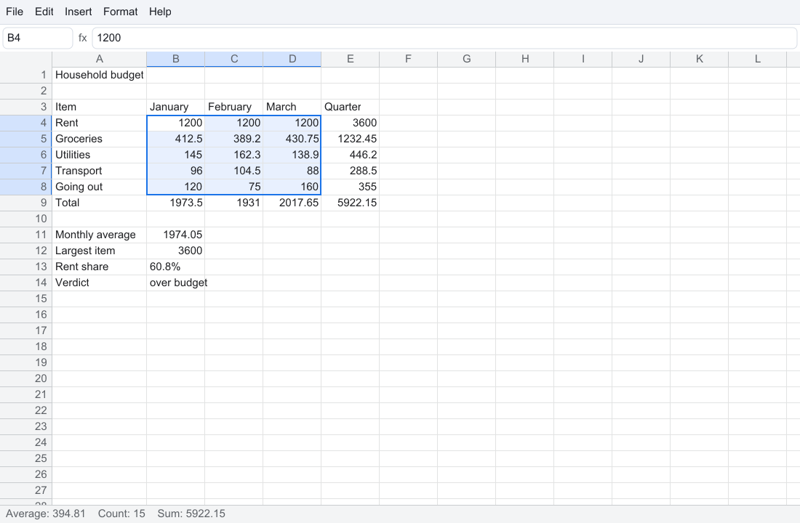

# abax

A spreadsheet in [sysl](https://github.com/sysl-lang/sysl): a formula engine that recalculates in
dependency order, and an application on [syslui-sdl](https://github.com/sysl-lang/syslui-sdl) with a
menu, a formula bar and the grid. Named for the *abax*, the Greek counting board the word "abacus"
comes from.

[DESIGN.md](DESIGN.md) has the shape and the roadmap.

## The formula engine

`sh.sysl.abax` is the library: values with Excel's coercion rules, A1 addresses up to `XFD1048576`
(with `$`, whole columns and rows, and sheet names), a formula parser on
[`sh.sysl.parsing`](https://github.com/sysl-lang/parsing)'s Pratt loop with Excel's precedence (`-2^2`
is 4, `2^3^2` is 64), a printer that writes a formula back in canonical form, about forty functions
(`SUM`, `AVERAGE`, `IF`, `VLOOKUP`, `INDEX`, `MATCH`, the text functions and the rest), and a sparse
`Sheet` that recalculates exactly what depends on a change, in dependency order, with a cycle shown as
a circular-reference error rather than looped on. Numbers are shown in General format. It needs
nothing but an allocator.

```sysl
import sh.sysl.abax.sheet

var s = sheet("Sheet1")

s.set("A1", "4").unwrap()
s.set("A2", "=A1^2/2").unwrap()
s.set("A3", "=IF(A2>5,\"big\",\"small\")&\" \"&SUM(A1:A2)").unwrap()

print(s.display("A3"))      // big 12
s.set("A1", "1").unwrap()
print(s.display("A3"))      // small 1.5
print(s.formula("A2").unwrap())     // =A1^2/2
```

```
dependencies {
  abax { git = "github.com/sysl-lang/abax", version = "0.1.0" }
}
```

## The application



`app/` is `abax-app`, a window on [syslui-sdl](https://github.com/sysl-lang/syslui-sdl): a menu bar, a
name box and a formula bar, the grid, and a line that shows the average, count and sum of the
selection, or why a formula was refused. The grid draws only the cells on screen, so all of
`A1:XFD1048576` scrolls at the same speed.

```
sysl build app
app/abax-app                    an empty sheet
app/abax-app --demo             a small budget to look at
app/abax-app --demo --select B4:D8 --shot shot.png
```

`--shot` draws one frame with no window and writes it to a PNG; `--cell B2==SUM(A1:A9)` (repeatable),
`--cut` and `--select` set the sheet up first, so the picture can be checked by a program.

| Key | Does |
|---|---|
| arrows, Tab, Shift+Tab, Enter, Shift+Enter | move one cell |
| Shift + an arrow, Shift + a click, a drag | stretch the selection |
| Ctrl + an arrow | to the edge of the block of filled cells |
| Home, Ctrl+Home, Ctrl+End | the row's first cell, A1, the last cell used |
| Page Up, Page Down | a screenful |
| typing | starts the cell over; Enter or Tab puts it in, Escape throws it away |
| F2, a double click | change what is in the cell; F2 again makes the arrows move out of it |
| Delete, Backspace | empty the selection |
| a click on a column letter or row number, or the corner | the whole column, row or sheet |
| a drag on a column letter's right edge | the column's width |
| Ctrl+N, Ctrl+Q, Ctrl+A | new sheet, quit, select all (⌘ on a Mac) |
| Ctrl+Z; Ctrl+Y or Ctrl+Shift+Z | undo; redo — every edit, a paste or an insertion being one step |
| Ctrl+C, Ctrl+X, Ctrl+V | copy, cut, paste; Escape lets the dashed outline of a copy or cut go |
| Ctrl+D, Ctrl+R | fill down, fill right |

**Copy and paste** follow Excel. A pasted formula moves its relative references by how far it
travelled and keeps its `$` ones; one cell pasted into a selection fills it. A cut pasted *moves*
the cells, and every formula that read them follows them. The system clipboard gets what the cells
show, as tab-separated text, so another program receives values; a paste from abax's own copy brings
the formulas, and text from another program is pasted as if typed. **Insert** adds rows above or
columns to the left of the selection, and deletes the selected rows or columns, adjusting every
formula on the sheet — a reference to a deleted cell becomes `#REF!`, a range losing some of its rows
shrinks.

Typing an address or a range (`B7`, `B2:D9`, `C:E`, `3:5`) into the name box and pressing Enter
selects it. A formula typed into the formula bar goes into the active cell on Enter; one calling a
function with the wrong number of arguments is refused there, with a message. Saving and opening
files are not written yet; their menu items say so.

## Files

The library reads and writes **CSV** (and TSV) and **`.xlsx`** as bytes, so it still needs no
operating system; `.xlsx` goes through [`sh.sysl.zip`](https://github.com/sysl-lang/zip) and
[`sh.sysl.xml`](https://github.com/sysl-lang/xml).

```sysl
val got = open_bytes("budget.xlsx", read_bytes("budget.xlsx")?)?    // a Loaded: .sheet and .notes
val bytes = save_bytes(got.sheet, "budget.csv")?                    // a Buf[u8], by extension
```

`read_csv(bytes, sep, formulas)`, `write_csv(sheet, sep)`, `read_xlsx(bytes)` and `write_xlsx(sheet)`
are underneath, for a program that knows its format.

**CSV** follows RFC 4180: quoted fields with separators, `""` and line breaks inside, CRLF, LF or CR
line ends, a UTF-8 byte-order mark dropped, and `,`, `;` or a tab between fields. Each field is read as
if typed, so numbers are numbers — but **a field starting with `=` is text unless formulas are asked
for**, since a formula in a file someone sent is a way to make the sheet do what its reader did not
ask. Writing gives the values, never the formulas, numbers as the shortest text that reads back the
same, so a round trip keeps every digit. Lost: formulas, column widths, and the difference between
text that looks like a number (`007`) and the number.

**`.xlsx` reading** follows the package's relationships to the **first sheet** (the notes name any
others, which are left out until abax has several sheets): numbers, shared strings including rich
text (the runs joined, the formatting dropped, phonetic guides left out), inline strings, logicals,
errors, and formulas **with the values the file cached for them, kept until something recalculates**.
A shared formula is copied into each of its cells, moving its relative references; Excel's `_xlfn.`,
`_xlws.` and `_xludf.` prefixes are dropped; `_xHHHH_` escapes are read. A formula abax cannot read
(an array constant, a structured reference) keeps its cached value as a constant and is noted; one
calling a function abax does not know is kept and shows `#NAME?` once recalculated. Column widths are
read where the file set them, in pixels by Excel's rule for its default font (a width `w` is
`floor((256w + 18) / 256 × 7)` pixels, so Excel's standard 8.43 characters is 64). Malformed input —
a zip that is not a package, a missing part, XML that is not well formed, a cell past `XFD1048576`, a
shared-string index out of the table — is refused with what is wrong.

**`.xlsx` writing** gives the smallest package Excel and LibreOffice open without repair: content
types, relationships, a workbook of one sheet, the sheet, shared strings and a one-style style sheet.
Formulas are written without their `=` and with abax's value cached and typed, `_xlfn.` added where
Excel expects it; numbers are the shortest round-trip text; widths are written back by the same rule.
The same sheet gives the same bytes. Lost: nothing abax holds, but abax holds no formatting yet.

### abax-cli

```
sysl build cli
cli/abax-cli budget.xlsx                    every stored cell and what it shows
cli/abax-cli budget.xlsx --cell B4 --cell C9
cli/abax-cli convert budget.xlsx budget.csv by extension: .csv, .tsv, .xlsx
cli/abax-cli dump budget.xlsx               address, input and exact value, tab-separated
```

`--formulas` makes a CSV or TSV field starting with `=` a formula. What a reader could not keep is
printed on stderr as `note:` lines.

### The LibreOffice oracle

`zsh oracle/oracle.zsh` has abax write a workbook of every function and operator (`oracle/cases.txt`
over the data in `oracle/data.tsv`) as `.xlsx`, LibreOffice recalculate it headless in a private
profile and write it again, and abax read LibreOffice's file back. It compares every value and every
formula, and writes `sh/sysl/abax/tests_oracle.sysl`, so `sysl test .` checks the agreed values without
LibreOffice. Of 189 formulas, 169 agree with LibreOffice 26.8 and 20 are documented differences where
abax follows Excel (logicals are not numbers to Excel, `0^0` is `#NUM!`, the first error from the left
wins, and so on), each stated in the test. Every formula survives the round trip through LibreOffice.

## Licence

ISC — see [LICENSE](LICENSE).
